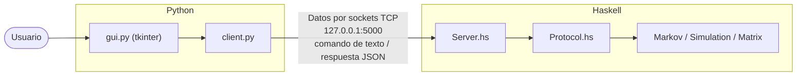
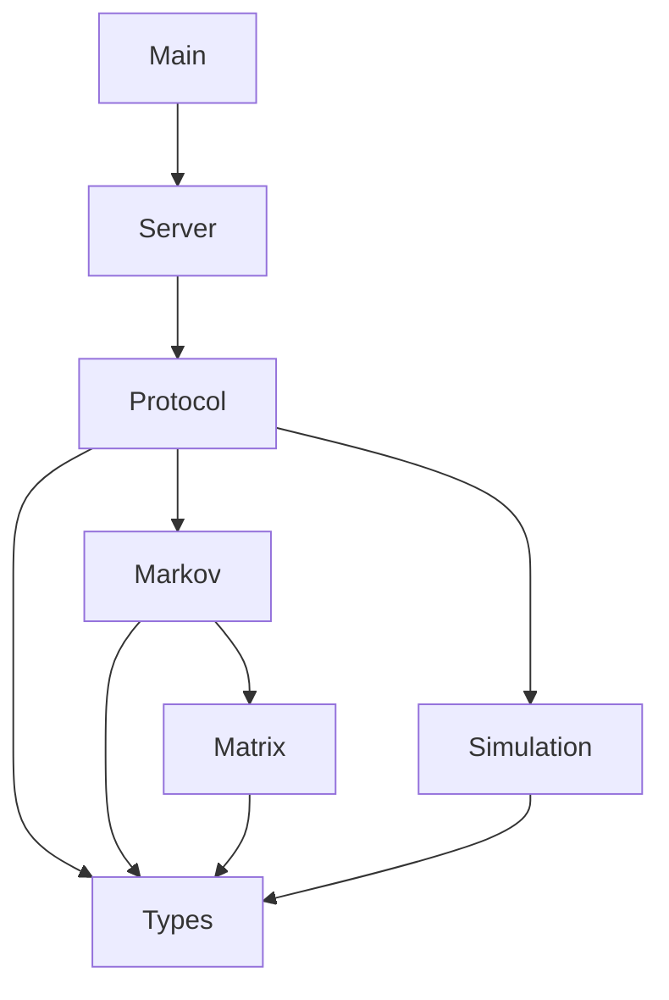

# Simulador de Cadenas de Markov y Transiciones de Estado

Proyecto de **Programación Funcional**. Un simulador de cadenas de Markov cuyo núcleo está escrito en **Haskell** (puro, sin estado mutable) y que se maneja desde una interfaz gráfica en **Python (tkinter)**. Ambas partes se comunican por **sockets TCP** locales.

## Descripción

Una cadena de Markov es un sistema con un conjunto de estados donde la probabilidad de pasar al siguiente estado depende únicamente del estado actual. Todo el comportamiento se describe con una **matriz de transición** $P$: el elemento $P_{ij}$ es la probabilidad de pasar del estado $i$ al estado $j$, y cada fila suma 1.

Con este simulador el usuario puede:

| Operación | Qué calcula |
|---|---|
| **Validar** | Comprueba que la matriz sea cuadrada, sin probabilidades negativas y con cada fila sumando 1. |
| **Simular** | Genera una trayectoria aleatoria de *n* pasos desde un estado inicial. |
| **Distribución tras *n* pasos** | Calcula la probabilidad de estar en cada estado después de *n* pasos: $\pi_n = \pi_0 P^n$. |
| **Distribución estacionaria** | Calcula la distribución $\pi$ a la que converge la cadena a largo plazo: $\pi = \pi P$. |

Funciona con cualquier número de estados.

## Arquitectura

La interfaz y el núcleo son procesos separados. Python solo dibuja la ventana y manda comandos; toda la lógica de Markov vive en Haskell.



### Dependencias entre módulos de Haskell



`Server` y `Main` son los **únicos** módulos con `IO`. Todo lo demás son funciones puras.

### Estructura del proyecto

```
.
├── markov-simulator.cabal
├── app/
│   └── Main.hs          -- arranca el servidor
├── src/
│   ├── Types.hs         -- Vector, Matrix, Chain
│   ├── Matrix.hs        -- producto vector × matriz
│   ├── Markov.hs        -- validación, distribución tras n pasos, estacionaria
│   ├── Simulation.hs    -- trayectorias aleatorias (generador explícito)
│   ├── Protocol.hs      -- texto ⇄ comandos y respuestas JSON
│   └── Server.hs        -- sockets (único módulo de red)
└── gui/
    ├── client.py        -- cliente de sockets
    └── gui.py           -- interfaz tkinter
```

Cada módulo tiene una sola responsabilidad.

## Protocolo de comunicación

El cliente manda **un comando por línea** y el servidor responde **una línea de JSON**.

| Comando | Ejemplo |
|---|---|
| Cargar la cadena | `LOAD Sol,Lluvia \| 0.9,0.1;0.5,0.5` |
| Simular *n* pasos | `SIMULATE Sol 10` |
| Distribución tras *n* pasos | `DIST Sol 5` |
| Distribución estacionaria | `STATIONARY` |

Las filas de la matriz se separan con `;` y los valores con `,`.

**Respuestas**

```json
{"ok":true}
{"ok":true,"path":["Sol","Sol","Lluvia","Sol"]}
{"ok":true,"dist":{"Sol":0.86,"Lluvia":0.14}}
{"ok":false,"error":"La fila 1 suma 0.9, debe sumar 1"}
```

La cadena cargada se conserva mientras dure la conexión; la GUI la vuelve a cargar antes de cada consulta para que siempre coincida con lo que se ve en pantalla.

## Diseño funcional

- **Funciones puras.** Markov, simulación, validación y protocolo no tienen efectos secundarios: mismas entradas, mismas salidas.
- **Sin ciclos ni variables mutables.** Se usa recursión (`converge`, `serve`, `splitOn`) y funciones de orden superior (`iterate`, `map`, `zipWith`, `scanl1`, `findIndex`, `filter`).
- **Aleatoriedad pura.** `simulate` recibe el generador como argumento y lo devuelve actualizado, sin estado oculto. La semilla de cada consulta se genera una sola vez en el servidor, en la frontera de `IO`.
- **Errores como valores.** La validación y el parseo usan `Either String`, encadenados con notación `do` en la mónada `Either` (código puro, sin efectos).
- **`IO` aislado.** Solo `Server.hs` y `Main.hs` hacen `IO`. El estado de la sesión (la cadena cargada) viaja como argumento de la recursión en `serve`, sin `IORef`.

### Cómo se calcula cada cosa

- **Distribución tras *n* pasos:** `iterate (`vecMat` m) v0 !! n`, es decir, multiplicar el vector por la matriz *n* veces.
- **Simulación:** en cada paso se toma un número uniforme $u \in [0,1)$ y se elige el primer estado cuya probabilidad acumulada (`scanl1 (+)`) supera a $u$.
- **Distribución estacionaria:** se itera desde la distribución uniforme hasta que dos pasos consecutivos difieren menos de $10^{-9}$, con un tope de 100 000 pasos. Cada paso se promedia con el anterior (cadena "perezosa"), lo que no cambia la distribución estacionaria pero evita que las cadenas periódicas oscilen sin converger.

### Verificación

Con la cadena `Sol/Lluvia` (`[[0.9,0.1],[0.5,0.5]]`), una simulación de 100 000 pasos dio una frecuencia de "Sol" de 0.8332, frente a 0.8333 (5/6) calculado analíticamente: simulación y cálculo concuerdan.

## Requisitos

| Herramienta | Versión usada |
|---|---|
| GHC | 9.4.7 |
| cabal | 3.8.1.0 |
| Python | 3.12 o superior, con tkinter |

Paquetes de Haskell (los descarga cabal): `random` 1.2.x y `network` 3.1.x. La GUI de Python usa solo la biblioteca estándar (`tkinter`, `socket`, `json`).

La forma más sencilla de instalar GHC y cabal es [GHCup](https://www.haskell.org/ghcup/).

## Cómo ejecutarlo

1. Desde la carpeta del proyecto, arranca el servidor en una terminal (la primera vez compila y descarga dependencias):

   ```
   cabal run markov-server
   ```

   Debe aparecer `Servidor escuchando en 127.0.0.1:5000`.

2. En otra terminal, abre la GUI:

   ```
   python gui/gui.py
   ```

3. En la ventana:
   1. Escribe los estados separados por coma (sin espacios dentro de cada nombre) y presiona **Crear matriz**.
   2. Llena la matriz de transición (cada fila debe sumar 1).
   3. Elige el estado inicial y el número de pasos *n*.
   4. Usa los botones **Validar cadena**, **Simular**, **Distribución tras n pasos** o **Estacionaria**.

### Ejemplo

Estados `Sol, Lluvia` con matriz `0.9 0.1 / 0.5 0.5`:

- Distribución tras 2 pasos desde Sol: `Sol 0.8600, Lluvia 0.1400`.
- Distribución estacionaria: `Sol 0.8333, Lluvia 0.1667`.

### Probar el núcleo sin GUI

```
cabal repl
```

```haskell
import Types
import Markov
let c = Chain ["Sol","Lluvia"] [[0.9,0.1],[0.5,0.5]]
validate c
distribution c [1,0] 2
stationary c
```

## Limitaciones conocidas

- Los nombres de estado no pueden contener espacios ni repetirse.
- El servidor atiende **un cliente a la vez**.
- La distribución estacionaria se obtiene iterando, no resolviendo el sistema exacto. En cadenas reducibles (con varias distribuciones estacionarias) devuelve una que depende del punto de partida.
- Los cálculos usan `Double`, así que pueden aparecer errores de redondeo como `0.8600000000000001`.
- Cada comando `SIMULATE` usa una semilla nueva, por lo que la misma consulta da trayectorias distintas.

## Trabajo a futuro

- Estados absorbentes y clases comunicantes.
- Detectar y avisar si la cadena es periódica o reducible.
- Calcular la distribución estacionaria exacta resolviendo el sistema lineal.
- Visualizar la cadena como grafo en la GUI.
- Servidor concurrente para varios clientes.
- Pruebas automáticas basadas en propiedades (por ejemplo, con QuickCheck).